# InkBoard

**把一台闲置的 Android 墨水屏阅读器，改成书桌上的 AI 助理看板。**

手机上随口说一句，AI 排好今天；Mac 上的 Claude Code、Codex 在跑什么、卡在哪、等你批准什么，抬眼就能看到；邮件、日程、截止日、额度、行情、两个人的账本，都在一块不发光、不打扰的屏幕上。

[English summary](#english-summary) · [设计思路](docs/design.md) · [部署](docs/setup.md) · [网页编辑器](docs/editor.md) · [改造墨水屏](docs/device.md) · [Agent 与“需要你”](docs/agents.md) · [记账与小纸条](docs/ledger.md)

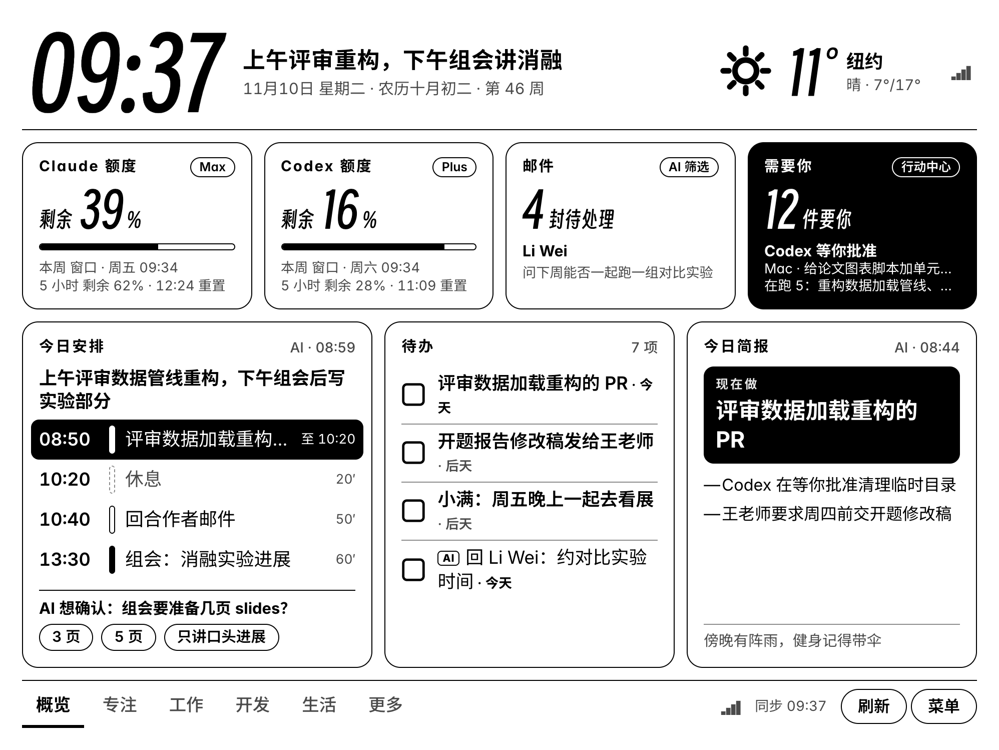

> 截图里的人物、任务、邮件、仓库、账目都是虚构的演示数据，`npm run demo` 就能在本地跑出同样的画面。

---

## 界面一览

### 墨水屏

| | |
|---|---|
| 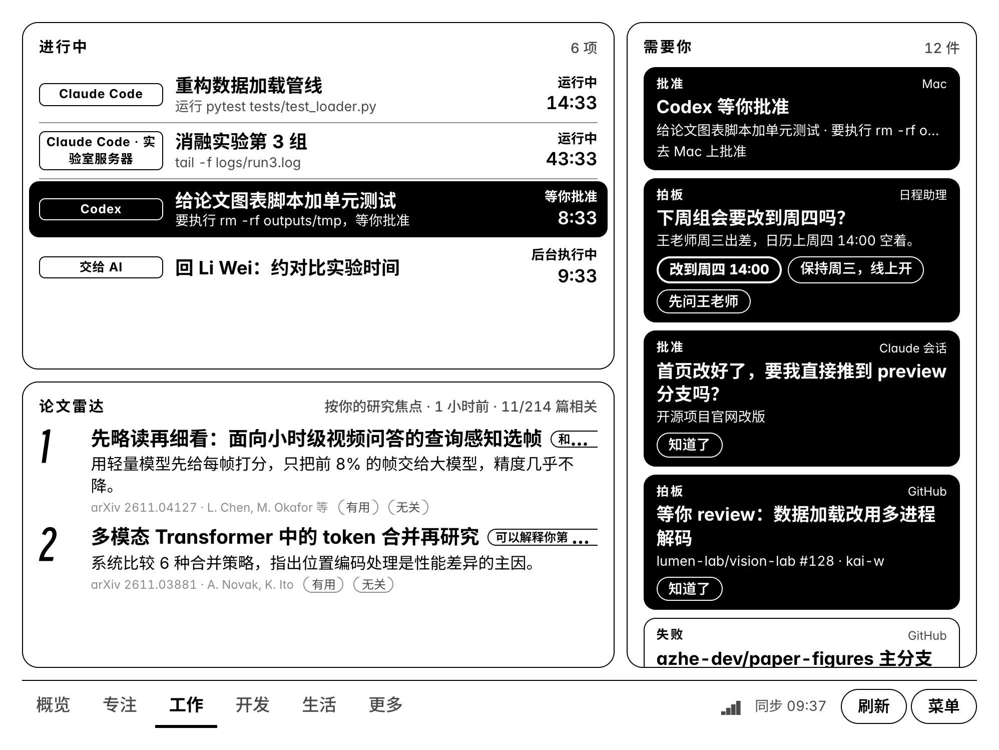<br>**工作**：进行中的 Agent 会话和交给 AI 的代办，右边是“需要你”，下面是按研究焦点挑的论文 | 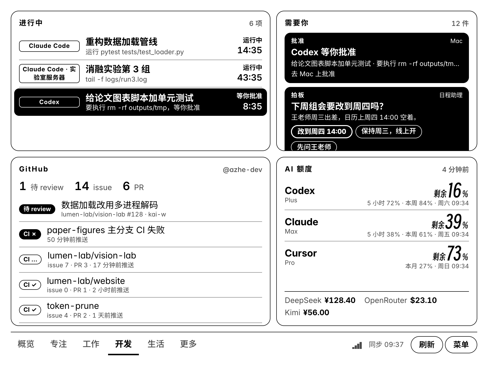<br>**开发**：GitHub 待 review 的 PR 和 CI 状态，订阅额度按“谁先用完”排序，底部是 API 余额 |
| 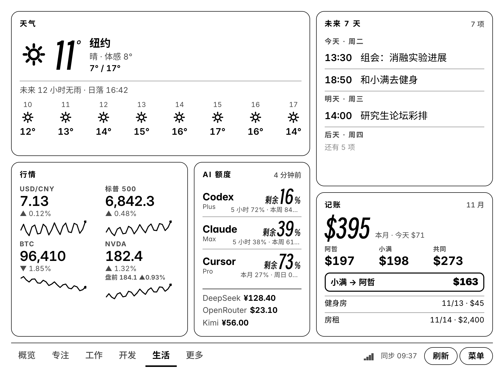<br>**生活**：逐小时天气、未来 7 天日程、行情（含美股盘前）、额度、两个人的账本 | 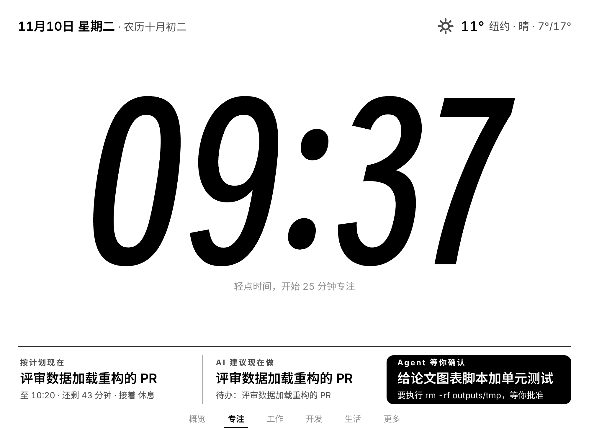<br>**专注**：超大时钟，轻点开始 25 分钟番茄钟；底部是当前计划块、AI 建议和等你的 Agent |
| 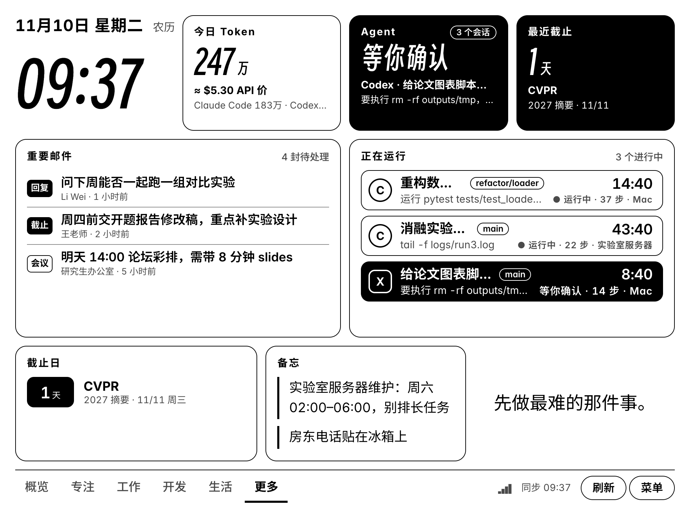<br>**更多组件**：时间日期、今日 Token、Agent 状态、最近截止、重要邮件、Agent 列表、截止日、备忘、座右铭 | 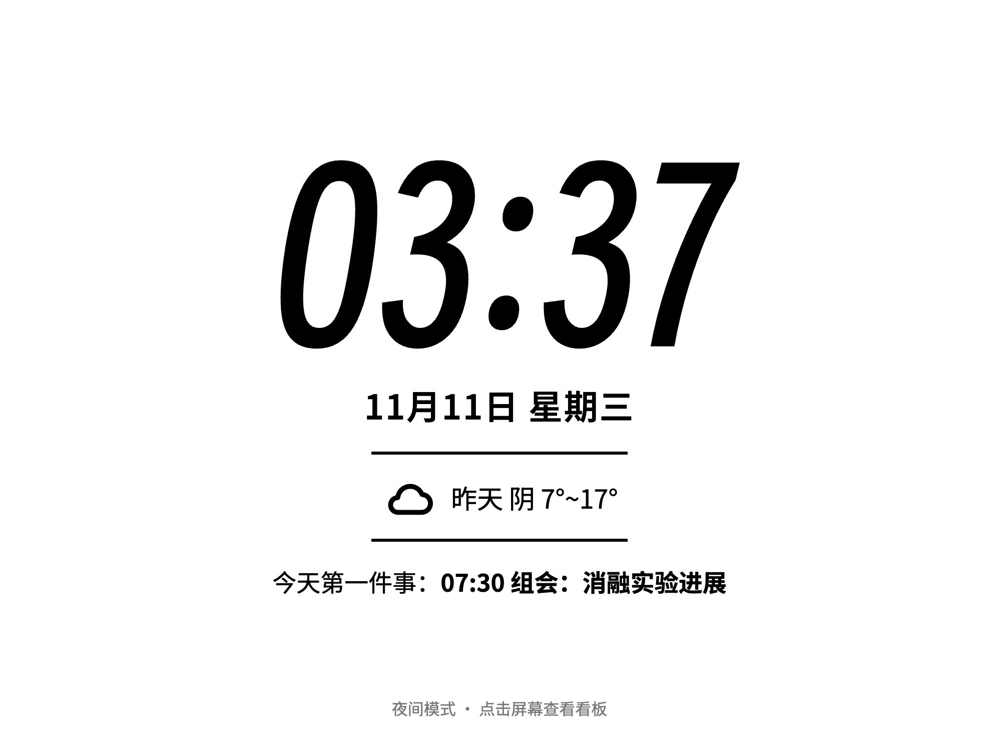<br>**夜间屏**：只剩时间、明天天气和明天第一件事，点一下回到看板 |

所有页面和组件都可以在编辑器里自由增删、拖拽、改尺寸，也支持竖屏。

### 手机

<table>
<tr>
<td width="25%">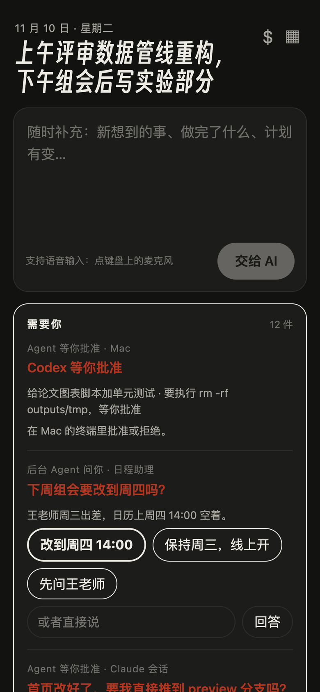</td>
<td width="25%">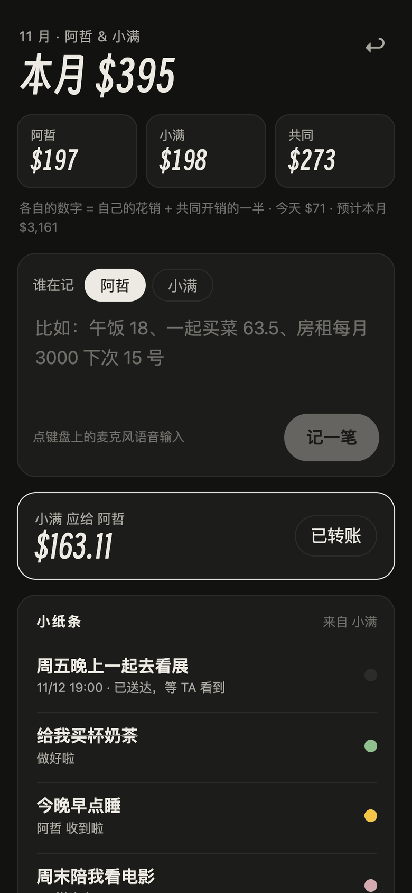</td>
<td width="25%">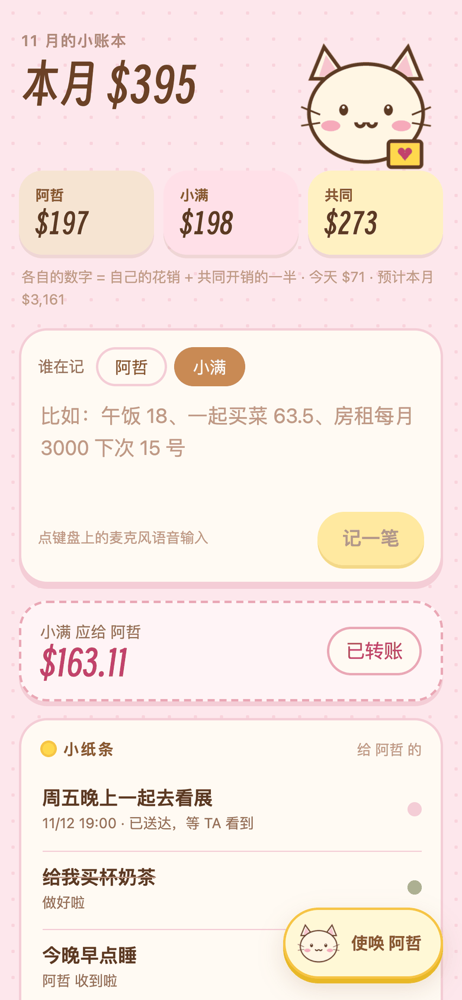</td>
<td width="25%">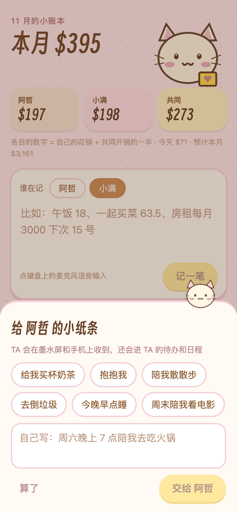</td>
</tr>
<tr>
<td><b>/c 今天</b>：一句话补充计划，在手机上处理“需要你”</td>
<td><b>/m 记账</b>：说一句就记上，算出谁该给谁</td>
<td><b>另一位的页面</b>：可爱主题，吉祥物可以换成自己的图</td>
<td><b>小纸条</b>：使唤一下对方，会进对方的待办和日历</td>
</tr>
</table>

### 网页编辑器

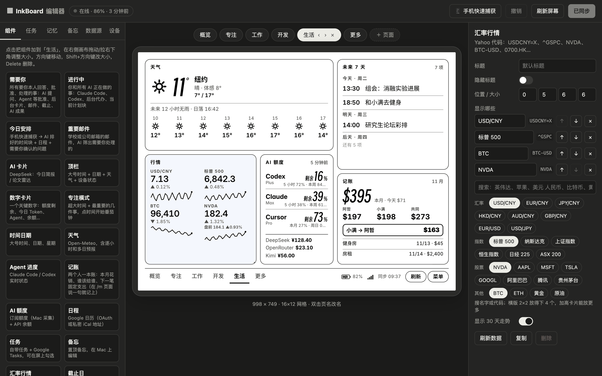

左边是组件库和各类设置，中间是阅读器的实时画布，右边是选中组件的属性。拖拽排版、改数据源、管理 AI 的长期记忆、看阅读器状态、远程刷新和重启，都在这一个页面里完成。逐项介绍见 [docs/editor.md](docs/editor.md)。

---

## 它解决什么问题

我们每天在十几个地方之间切换：终端里的 Agent、日历、邮箱、待办、AI 额度页面、行情 App。真正需要人做决定的事情散落其中，经常被错过；而手机和电脑屏幕本身又是最大的干扰源。

InkBoard 的做法是：

- **一个安静的屏幕**：墨水屏只在内容变化时刷新，没有通知横幅，没有红点。看板放在显示器旁边，抬眼就是全局。
- **一个收件箱叫“需要你”**：Agent 等你批准的操作、AI 拿不准要问你的问题、要回复的邮件、三天内到期的截止日、失败的 CI、另一半写给你的小纸条，全部汇到同一处，在阅读器或手机上点一下就能回答。
- **AI 负责整理，你负责决定**：早上把想做的事一股脑说给手机，AI 结合日历排出时间块，标出哪些能交给 Agent 去做；拿不准的会问你，不会替你编。

## 看板上有什么

| 页面 | 内容 |
|---|---|
| 概览 | 时间天气、Claude / Codex 额度、待处理邮件数、“需要你”、今日计划、待办、AI 简报 |
| 专注 | 当前时间块、倒计时、下一件事 |
| 工作 | 正在跑的 Agent 会话（标题、当前步骤、工具调用数、耗时）、日程、论文雷达 |
| 开发 | GitHub 仓库与 CI、PR review 请求、各家 AI 额度与 API 余额 |
| 生活 | 天气、行情（含美股盘前盘后）、汇率、记账、截止日 |

页面、组件、位置、字号都在 Mac 的网页编辑器里拖拽修改，保存后阅读器在下一次同步时更新，不用重新打包 App。

## 架构

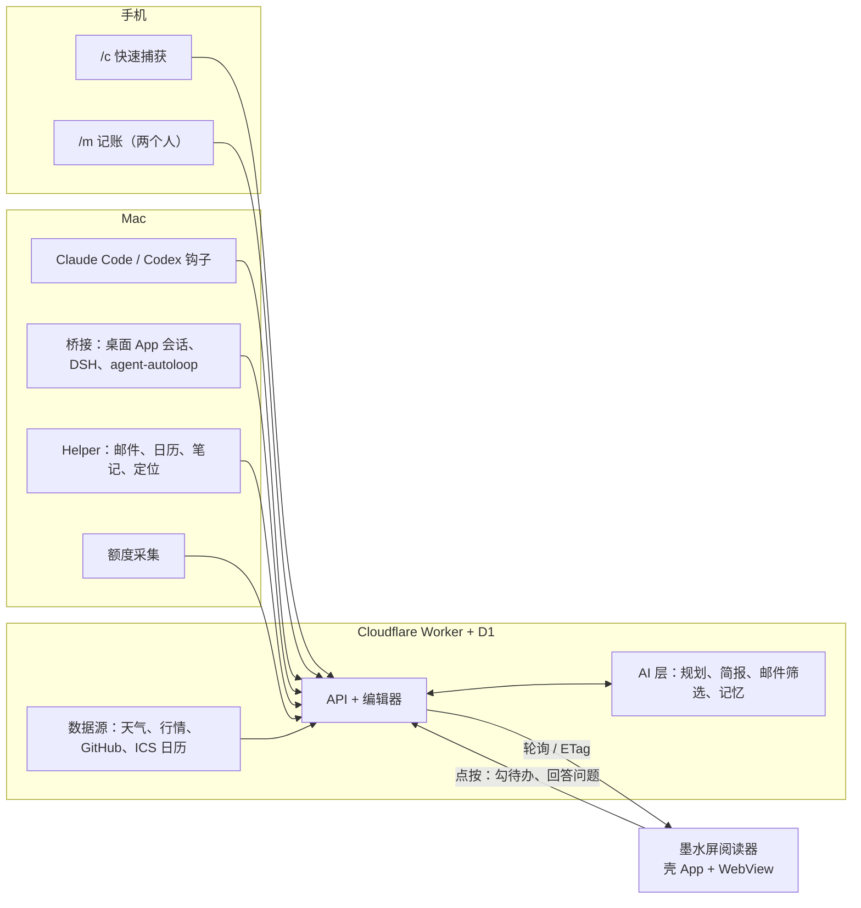

三件事分开：**阅读器只管显示和点按，云端只管数据和 AI，Mac 只管采集本机才拿得到的东西**（Agent 会话、订阅额度、邮件）。任何一端掉线，其余照常工作，屏幕显示最后一次数据并标出“X 分钟前”。

| 部分 | 目录 | 技术 |
|---|---|---|
| 云端、编辑器、手机页 | `server/` | Cloudflare Workers（Hono）、D1、Preact、esbuild |
| 阅读器 App | `android/` | 不用 Gradle 的极简 Java 壳：全屏 WebView、开机自启、刷新控制、前光、电池保养 |
| Mac 采集端 | `mac/` | Python + 一个小 Swift Helper（申请日历、邮件、定位权限用） |
| 工具 | `tools/` | 探测厂商 e-ink 刷新接口、替换系统 WebView |

## 快速开始

需要：一台能开 USB 调试的 Android 墨水屏阅读器（Android 8 及以上）、一个 Cloudflare 账号（免费额度足够）、一个 OpenAI 兼容的大模型 API key（默认 DeepSeek）。Mac 采集端可选。

```bash
git clone https://github.com/ooooooomygosh/inkboard.git
cd inkboard/server && npm install
cp wrangler.toml.example wrangler.toml   # 填上你的 D1 database_id
cp .dev.vars.example .dev.vars           # 本地开发用的三个口令
npm run db:init && npm run dev           # 本地预览：http://localhost:8787/admin
```

只想先看看效果：`npm run demo:seed && npm run demo`，会在一个独立的本地数据库里灌入截图里那套虚构数据，打开 http://localhost:8788/admin。

上线、装 App、接 Mac 的完整步骤见 [docs/setup.md](docs/setup.md)。

## 设计上的几个选择

- **WebView 而不是原生界面**：布局用 Web 技术写，改完即生效；壳 App 通过反射调用厂商的刷新接口，小区域变化用快速局刷，翻页和定时清残影用全刷。
- **云端聚合，设备轮询**：设备带 ETag 轮询，数据没变就是 304，几乎不耗电也不刷屏；有 Agent 在跑时自动加快频率。
- **AI 只读外部内容，不执行**：邮件、笔记、网页、小纸条进入提示词时都标为资料，不会被当成指令。
- **省 Token**：记忆按 token 预算裁剪，计划增量合并，结果缓存在 D1，模型只在有新输入或固定时间点运行。
- **可逆的设备改造**：隐藏系统应用用 `pm uninstall --user 0`，随时可以恢复；不刷机、不 root。

完整的思路和取舍写在 [docs/design.md](docs/design.md)。

## 隐私

所有数据存在你自己的 Cloudflare 账号里。设备上只保存一个设备令牌；管理口令、API key、GitHub 令牌存在 D1 的 `secrets` 里，只在编辑器里以打码形式显示。仓库不包含任何个人数据。

## 许可

代码以 [MIT](LICENSE) 许可发布。随附字体各自遵循其许可：Inter（OFL）、Noto Sans SC（OFL）、得意黑 Smiley Sans（OFL），许可文本在 `server/public/fonts/`。

---

## English summary

InkBoard turns a spare Android e-ink reader into a calm, always-on AI desk dashboard.

- **One inbox called "Needs you"**: permission requests from Claude Code / Codex, questions the AI planner is unsure about, mail that needs a reply, deadlines within three days, failed CI, review requests and notes from your partner. Answer them by tapping the reader or your phone.
- **AI planning from a sentence**: dump your day into the phone page; the planner merges it with your calendar into time blocks, marks what an agent can do for you, and asks when it is unsure.
- **Agent monitoring**: live state of Claude Code, Codex and other agent sessions (local and over SSH) via hooks and the desktop apps' session stores.
- **Also on the board**: calendar (any ICS link), triaged mail, weather, markets with US pre/post-market, GitHub CI, AI quotas and API balances, a shared ledger for two people with voice input and recurring-bill detection.
- **Stack**: Cloudflare Workers + D1 (Hono, Preact), a tiny Gradle-free Java launcher with a full-screen WebView and vendor e-ink refresh control, and a Python/Swift collector on the Mac.

The UI and docs are in Chinese. Start with [docs/setup.md](docs/setup.md); the design notes are in [docs/design.md](docs/design.md). MIT licensed.

## QQ 群协作与团队开发台

独立团队部署、QQ 群消息接入、项目记忆、方案整理和本机 Agent 接力，见 [team/README.md](team/README.md)。团队数据使用独立数据库，与个人看板分开。
