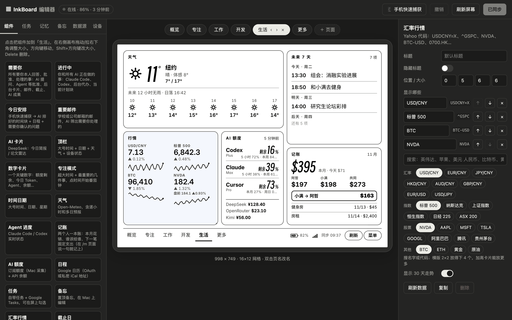
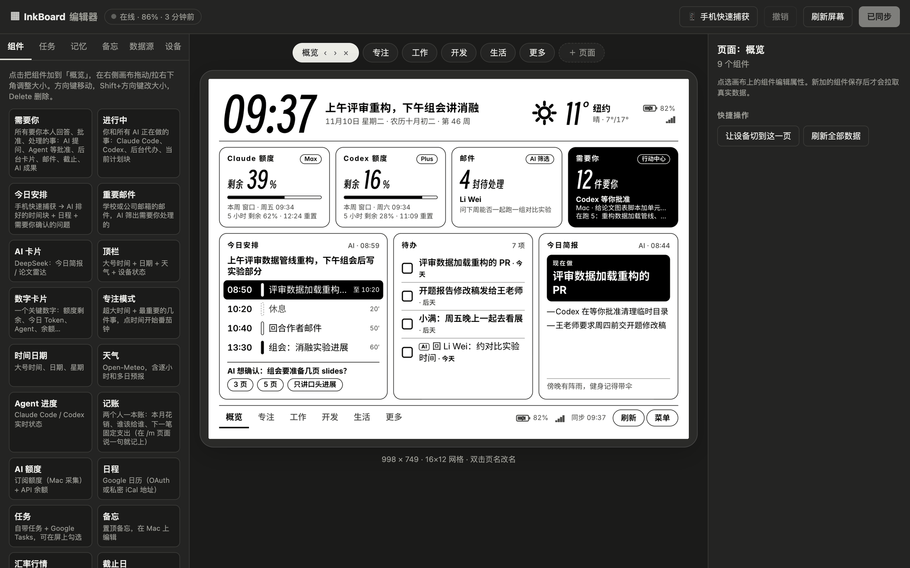
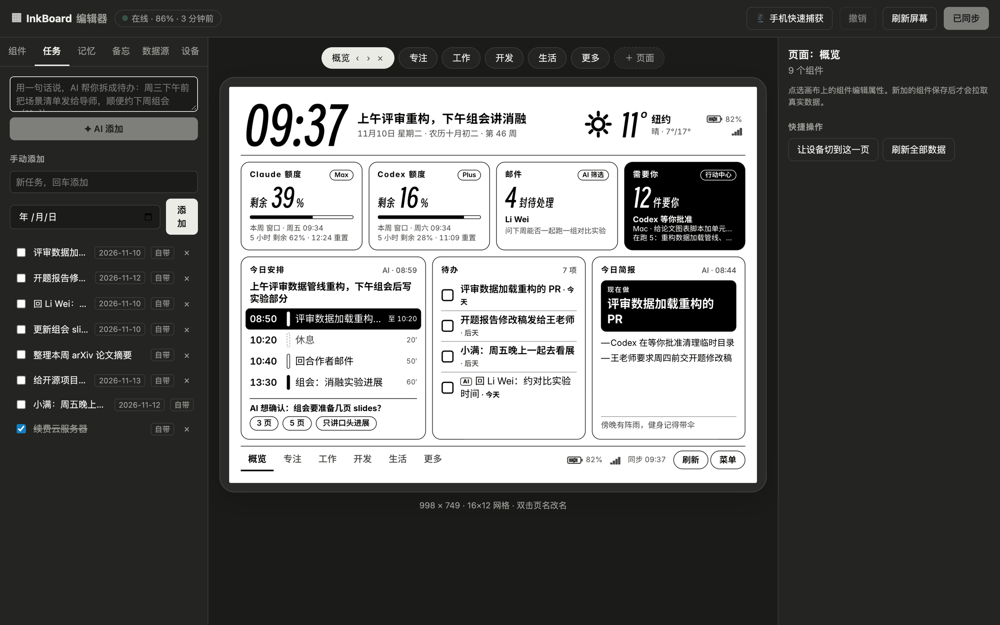
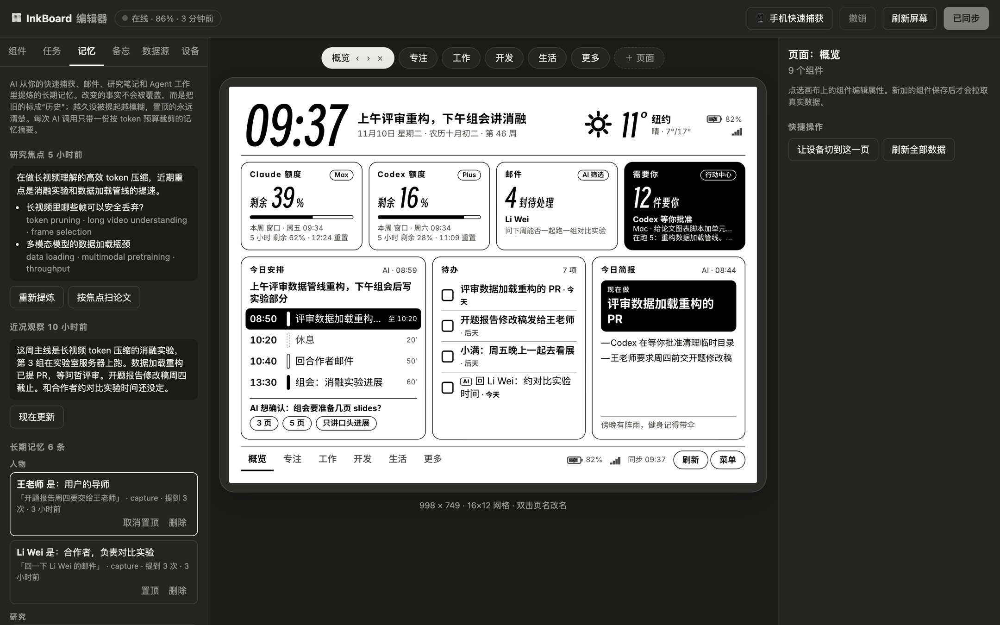
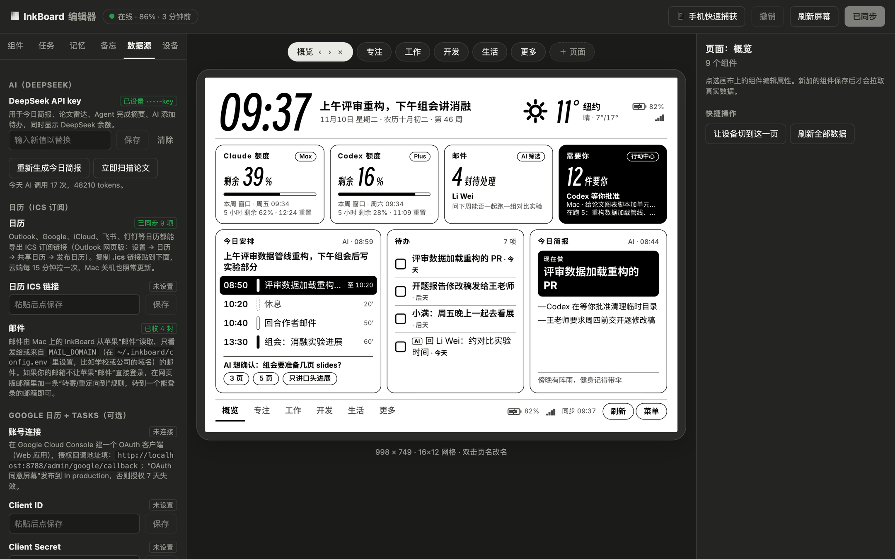
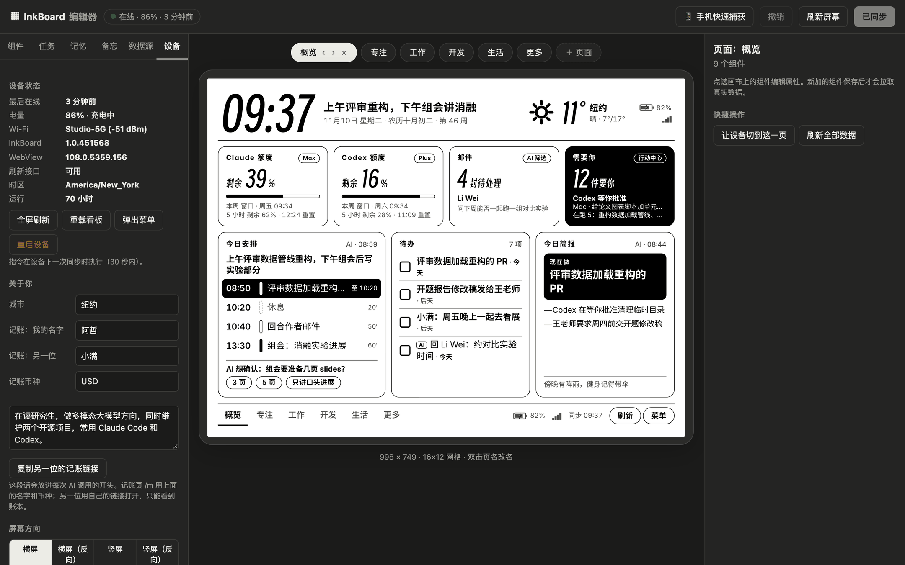

# 网页编辑器

编辑器在 `/admin`，是整套系统的控制台：看板长什么样、数据从哪来、AI 记住了什么、阅读器现在什么状态，都在这里看和改。所有截图都是 `npm run demo` 的虚构数据。



## 布局

界面分三栏：

| 区域 | 作用 |
|---|---|
| 左栏 | 六个标签：组件、任务、记忆、备忘、数据源、设备 |
| 中间 | 阅读器的实时画布，按真实尺寸（例如 998×749）等比缩放，显示的是真实数据 |
| 右栏 | 当前页面或选中组件的属性 |

顶栏显示阅读器在线状态、电量和上次同步时间，右边是“手机快速捕获”二维码、撤销、让阅读器立即刷新、保存状态。

## 组件：拖拽排版



- **组件库**：左栏列出全部 20 多种组件，点一下加到当前页面。
- **画布**：拖动移动，拉右下角改大小，网格自动吸附；方向键微调位置，Shift + 方向键改大小，Delete 删除；重叠的组件会用红色虚线框标出。
- **页面**：顶部是页面标签，可以新建、改名（双击）、调整顺序、删除。每个页面都是阅读器上可以左右滑动的一屏。
- **属性面板**：选中组件后，右栏显示它的所有设置。不同组件有不同的字段：行情组件可以按名字搜代码，中文名也能搜，带常用汇率、指数、股票的快捷选项，可以排序、改显示名；论文雷达可以填关键词和 arXiv 分类；数字卡片可以选显示哪一个指标；底部导航可以配按钮动作。
- **快捷操作**：“让设备切到这一页”会让阅读器马上翻到正在编辑的页面；“刷新数据”只刷这一个组件的数据源。

每次保存都会记版本号，阅读器在下一次同步时（默认 30 秒内）换上新布局，并做一次全刷清残影。

## 任务



看板自带的待办，也可以同步 Google Tasks。可以手动添加，也可以用一句话让 AI 拆：“周三下午前把实验结果发给导师，顺便约下周组会”会拆成两条，各带截止时间和优先级。AI 判断能交给 Agent 的待办会带 `AI` 标记。

## 记忆



AI 从快速捕获、邮件、研究笔记和 Agent 工作里提炼的长期记忆，分成三块：

- **研究焦点**：最近在推进的问题和检索词，可以一键重新提炼、按焦点扫论文；
- **近况观察**：AI 每晚更新的工作日志；
- **长期记忆**：按人物、项目、研究、偏好、日常分组的事实，每条带原话证据、来源、被提到的次数，可以置顶、修改、删除，也可以手动告诉 AI 一条。

## 数据源



- 大模型 API key，以及今天 AI 调用了多少次、用了多少 Token；
- 日历 ICS 订阅链接和同步状态；
- 邮件同步状态和设置说明；
- Google 日历和 Tasks 的 OAuth；
- GitHub 令牌（个人和组织各一个）；
- 各家 API 的余额 key。

所有密钥只显示末尾几位，可以替换或清除，不会回传到网页。

## 设备



- **设备状态**：上次在线、电量和充电、Wi-Fi 信号、App 和 WebView 版本、刷新接口是否可用、时区、运行时长；
- **远程指令**：全屏刷新、重载看板、弹出原生菜单、重启设备，在阅读器下一次同步时执行；
- **关于你**：城市、一两句自我介绍（放进每次 AI 调用）、记账的两个名字和币种，以及复制另一位的记账链接；
- **屏幕方向**：横屏、竖屏和各自的反向；
- **前光与对比度**：交给系统、关闭、固定亮度，或按时间段自动调亮度和色温；
- **电池保养**：常插电时的充电区间；
- **刷新与同步**：同步间隔、Agent 运行时的加速间隔、定时全刷、局刷上限、自动回首页；
- **夜间模式**：时间段，期间显示夜间屏；
- **网格与字体**：网格行列数、间距、字号缩放、标题样式、数字字体。

## 自己跑一份

```bash
cd server
npm install
cp .dev.vars.example .dev.vars
npm run demo:seed     # 建一个独立的本地演示数据库，灌入虚构数据
npm run demo          # http://localhost:8788/admin，口令是 .dev.vars 里的 ADMIN_TOKEN
```

演示数据库和正常开发用的本地数据库分开存放，删掉 `server/.wrangler/demo` 就恢复原状。阅读器画面在 `/d?preview=1`，手机页在 `/c` 和 `/m`。
