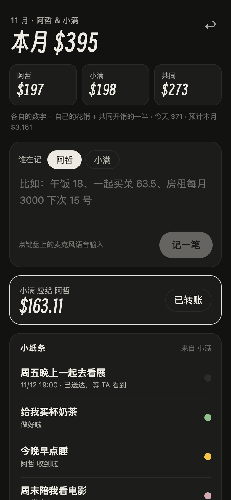
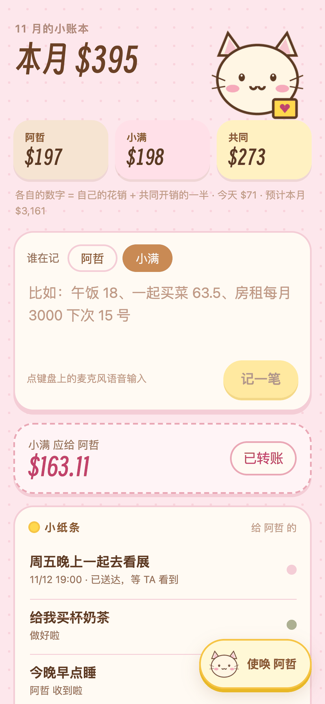
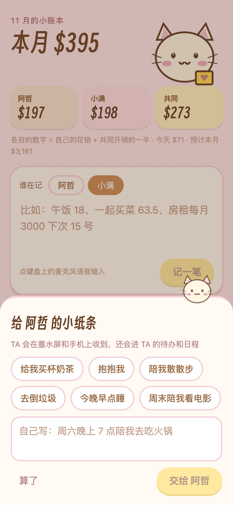

# 记账与小纸条

两个人一本账，说一句话就记上。页面是 `/m`，加到手机主屏幕后像 App 一样用。

  

## 怎么记

在输入框里说（键盘上的麦克风就行）：

| 你说 | AI 记成 |
|---|---|
| 午饭 18 | 一次性花费，餐饮，你付的 |
| 和 TA 一起买菜 63.5 她付的 | 一次性花费，共同，对方付的 |
| 房租每月 3000 我们一起，下次 15 号 | 固定支出，每月，共同，锚定下次扣款日 |
| Claude 每月 20 美元 | 固定支出，每月，按当天汇率换算 |
| 房租这期交了 | 不重复记账，只更新这一项的扣款日 |
| Netflix 退订了 | 停掉这一项，以后不再计入 |

- 周期支持每周、每两周、每月、每季度、每年。固定支出到期自动计入，不用每次再报。
- 外币按 [Frankfurter](https://frankfurter.dev)（欧洲央行汇率）当天的汇率换算成基础货币。
- 在 `/c` 今天页说的话里带了金额，会先拆出来记账，剩下的再交给规划 AI。
- 记错了点 ×，删掉重说。

## 两个人

- “设备 → 关于你”里填两个名字和基础货币。
- 你用管理口令登录 `/m`；另一位用专属链接（“复制另一位的记账链接”），这个链接只能打开账本，看不到看板的其他内容。
- 每笔记录谁付的、是否共同。页面上的“我 / TA”数字 = 自己的花销 + 共同开销的一半；“谁应给谁”是累计的差额，转账后点“已转账”结清。
- 墨水屏上的“记账”组件显示本月总额、两个人各自的数字、谁该给谁、下一笔固定支出。

## 另一位的页面：可爱主题和小纸条

另一位打开的页面会换成柔和的粉色主题（你自己想预览，打开 `/m?cute=1`）。

右下角有个“使唤”按钮，点开是一张小纸条：

- 几个一点就发的快捷选项（买杯奶茶、抱抱、散步、倒垃圾、早点睡、周末看电影），也可以自己写；
- 纸条进入看板主人的“需要你”（紧急，阅读器会响一声）和待办；
- 说了日期的，待办排到那天；说了具体时间的，还会进日历，规划 AI 也看得到；
- 主人点“收到啦 / 做好了 / 晚点”，或者把待办勾掉，对方页面上的状态马上跟着变。

### 换成你们自己的图

页面上的吉祥物和“添加到主屏幕”的图标，有自定义图就用自定义的，没有就用仓库自带的小猫：

| 放进 `server/public/custom/` | 用在哪 | 建议尺寸 |
|---|---|---|
| `header.png` | 页面右上角的大图（透明背景） | 宽 276 左右 |
| `fab.png` | “使唤”按钮和纸条上的小图（透明背景） | 96×96 |
| `money-icon-180.png`、`money-icon-192.png`、`money-icon-512.png` | 手机主屏幕图标 | 对应尺寸，不透明 |

`public/custom/` 不进 git，`npm run deploy` 时会一起上传。换了图标后，手机上要删掉旧的主屏幕图标再重新添加一次。
